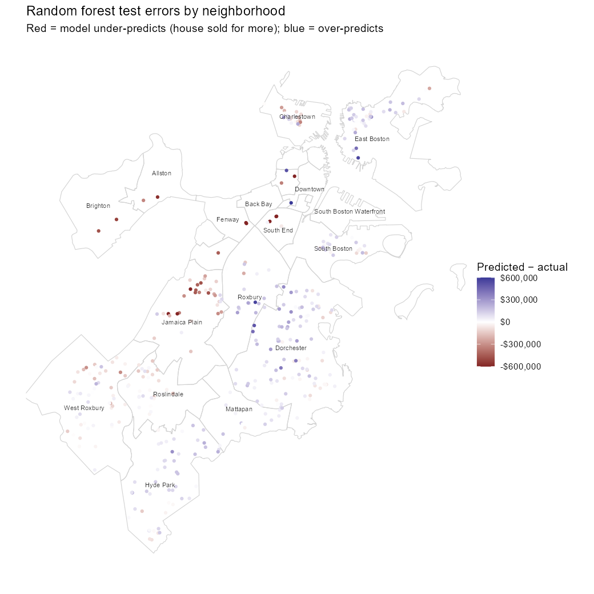

```{css}
/*| echo: false
.run { border-left: 6px solid #2e7d32; background: #e8f5e9 !important; }
.code-with-filename:has(.run) .code-with-filename-file { background: #2e7d32; color: white; }
```

# Overview

Machine learning is learning patterns from data to predict new data. It comes down to: choosing a model at the right level of complexity for your data. To predict well on data the model has never seen, the model has to learn the real pattern in the data. It shouldn't be so rough that it misses the pattern (*underfitting*), and it shouldn't be so flexible that it memorizes the noise (*overfitting*).

We can control complexity in two ways:

1.  **Selecting the model.** Different types of models (a straight line, a curve, a set of decision rules) have different levels of flexibility.
2.  **Tuning the parameters.** Each type of model has its own "moving parts", called *tuning parameters* or *hyperparameters*, that make it simpler or more complex.

To decide which model and which setting work best, we will use metrics such as **RMSE** (root mean squared error), which measures on average how far our predictions are from the true values. Lower is better.

In this lab we return to the Boston house sales, try several machine learning models to predict housing prices, and see if we can find a model that predicts housing prices well.

# The Data We Use Today

We will continue to use the Boston house sales data `boston_houses.csv`, with 1,327 sales of 1 to 3 family homes from 2015-2016.

[Data Download Link](https://www.dropbox.com/scl/fo/nb7q1qpg99lfonfjvnzx3/AKfuNrWWZrt8aptGdJLfXyg?rlkey=2t6f6fc6yu57moiv8aofyiaab&st=xx97m2pf&dl=0)

We will use the `caret` (Classification And Regression Training) package.

**To make the steps clear, please only run all the green code chunks. The code chunks left gray are just for explanation.**

```{r}
#| class-source: run

# install.packages(c("caret", "rattle", "gam"))

library(tidyverse)
library(caret)
library(rattle)
```

```{r}
#| class-source: run
#| eval: false
houses <- read_csv("data/boston_house.csv")
```

```{r}
#| message: false
#| echo: false
houses <- read_csv("../data/boston_house.csv")
```

Machine learning models use every column you give them as a predictor when you write `price ~ .`. So we first remove a few ID columns or text fields that the model doesn't need to learn from.

```{r}
#| class-source: run
modeldata <- houses |>
  select(-c(parcel_no, lat, lon)) |>
  drop_na()

glimpse(modeldata)
```

# Components in the Model Fitting Process

The `caret` package gives one common interface to hundreds of machine learning models. Once you understand what each model does, putting it into code is a pretty standard process. You fill in the same code skeleton every time, and `caret` does a lot of the work for you:

```{r}
#| eval: false
# Train
model <- train( 
  y ~ x,
  data = ...,          # training data
  method = ...,        # which model
  trControl = ...,     # how to validate (cross-validation)
  tuneLength = ...,    # how many parameter values to try
  preProcess = ...   # data preprocessing
)

# Predict
pred <- predict(model, newdata = ...)

# Test error
RMSE(pred, ...)
```

**Let's walk through each piece.**

## Data preprocessing

A machine learning model is just a pattern-finding machine, so it works better and runs more smoothly when the data is prepared. Preparation puts variables on equal footing so they can be compared fairly. Common steps include:

-   **Feature scaling (variable standardization).** Put predictors on the same scale. This matters most for models that use distances or penalties, like regularized linear regression. Otherwise `living_area` (in the thousands) dominates `bedrooms` (1 to 6) just because its numbers are bigger.
-   **Imputing missing values.** Missing data can be directly dropped, or, depending on the situation, imputed. We will talk about data imputation next time.
-   **Encoding categorical variables.** Turning categories like `style` into 0/1 dummy columns. When you use the formula interface (`price ~ .`), **`caret` does this automatically.**

In `caret`, you ask for feature scaling with one argument:

```{r}
#| eval: false
preProcess = c("center", "scale")
```

This performs **z-score standardization** on all of your variables. Each variable ends up with mean 0 and standard deviation 1: `(x - mean) / sd`.

## Split train and test

To know whether a model predicts well, we need to test it on houses where we **know the true price but the model has never seen them**. So we hold out part of the data as a test set. A common split is about 70% training and 30% testing.

The split is random, so we use `set.seed()` to make it reproducible: every model split data by the same random "seed". You'll see code like below, `createDataPartition()` gives you two datasets, `train_data` and `test_data`:

```{r}
#| class-source: run
# Set a random seed (any number works, but use the same one for every model)
set.seed(24)

train_index <- createDataPartition(
  y = modeldata$price,
  p = 0.7,
  list = FALSE
)

train_data <- modeldata[ train_index, ]
test_data  <- modeldata[-train_index, ]
```

The test set is used only once, at the very end, to report the final score. All the model fitting and tuning happens on the training data.

## Model

You choose the model by filling its name in the `method =` argument. `caret` supports over 230 machine learning algorithms, and each one has a short name. You can find them all in this list: <https://topepo.github.io/caret/available-models.html>.

For example, for a random forest model, `method = "rf"`. The list also tells you which R package the model needs and which tuning parameters it has.

## Parameter tuning

Every model has some moving parts to tune. Some have one, some have several. You can find each model's tuning parameters in the same list above. For example, a random forest's tuning parameter is `mtry`.

We usually don't know the best value in advance, so we try several and keep the one that works best. The argument `tuneLength` tells `caret` **how many** values to try:

```{r}
#| eval: false
tuneLength = 10
```

Alternatively, if you have a sense of what values may work, you can list them yourself with `tuneGrid`:

```{r}
#| eval: false
# this is to say, try exactly these 3 values and nothing else.
tuneGrid = expand.grid(mtry = c(2, 5, 10))
```

## Cross validation

How do we compare parameter choices without touching the test set? That's where **cross-validation** comes in. In **5-fold cross-validation**, `caret` splits the training data into 5 equal parts (folds). It then runs a round robin: it trains on 4 folds and validates on the 5th, repeating until every fold has been the validation set once. The 5 validation RMSEs are averaged into one number.

Using 5 different validation sets instead of one stabilizes the result, so a lucky or unlucky split doesn't trick us. We set this up once with `trainControl()`:

```{r}
#| eval: false
trControl = trainControl(method = "cv", number = 5)
```

## Test error

Everything above goes into the training function. Once the model is trained, we predict on the test set, and the `RMSE()` function gives us the **test error**:

```{r}
#| eval: false
# Get prediction
pred <- predict(model, newdata = test_data)

# Calculate test RMSE
RMSE(pred, test_data$price)
```

When the RMSE is in dollars, you can read it: "on average, our predictions are off by about \$X."

# Start: Try a Shortlist of Models

In practice you don't try all 230 models. For a given kind of problem there is a short list of good candidates. Our problem is a regression problem on tabular data (predicting a number from a table of variables), so we will try four models that range from simple to complex:

| Model                         | Complexity | Shape of the pattern it can learn |
|-------------------------|------------------|-----------------------------|
| Regularized linear regression | Low        | Straight-line relationships       |
| LOESS                         | Medium     | Smooth curves                     |
| Decision tree                 | Medium     | Step-like if-then rules           |
| Random forest                 | High       | Many trees averaged together      |

> Note: In other cases, there are models more suited to the data. For classification, you might shortlist logistic regression (glm) or k-nearest neighbors (knn). For images, perhaps a CNN-based model, which is not in `caret`. But each kind of data problem has its own shortlist to choose from.

## Regularized linear regression

This is the linear regression you already know, plus a **penalty**. Every time the model adds a variable, it weighs that variable's contribution against the cost of including it. Variables that don't help much get their coefficients shrunk toward zero. This keeps the model from overfitting when you have many predictors.

There are two common types of linear model regularization:

-   **Ridge regression** shrinks the coefficients of less important variables toward zero.
-   **LASSO regression** shrinks some coefficients all the way to zero, effectively **dropping** those variables from the model.

The `glmnet` (Elastic net) method mixes the two, so we use `method = "glmnet"`. It has two tuning parameters:

-   `alpha`: the mix between Ridge and LASSO (0 = pure Ridge, 1 = pure LASSO). It sets the type of penalty.
-   `lambda`: the strength of the penalty. A bigger `lambda` means less variables.

With `tuneLength = 10`, `caret` automatically tries combinations of `alpha` and `lambda` for you, so you don't need to specify them manually.

```{r}
#| class-source: run
set.seed(24)
glmnet_model <- train(
  price ~ .,
  data = train_data,
  method = "glmnet",
  trControl = trainControl(method = "cv", number = 5),
  tuneLength = 10,
  preProcess = c("center", "scale")
)

pred <- predict(glmnet_model, newdata = test_data)
glmnet_result <- RMSE(pred, test_data$price)
glmnet_result
```

That gives you the test RMSE.

To see which parameter values won the cross-validation, print `bestTune`:

```{r}
glmnet_model$bestTune
```

Here what we see is a little lasso (0.1) × a big push for removing variables.

To see the final model's coefficients at that `lambda`, use `coef()`:

```{r}
coef(glmnet_model$finalModel, glmnet_model$bestTune$lambda)
```

Only one variable is dropped here (the one whose coefficient shown as `.`). Keeping most of the variables gave the best predictions. But this is not an explanation of relationships: there are no significance tests, and variables are kept only because they help prediction.

## LOESS

LOESS (LOcally Estimated Scatterplot Smoothing) fits **curves** instead of straight lines. Instead of fitting one line to all the data, it fits many small regressions, each one using only the nearby points, and joins them into a smooth curve. In `caret` we use `method = "gamLoess"`, which fits a LOESS curve for each numeric predictor and adds them up.

Its tuning parameters are:

-   `span`: the share of the data used in each local fit. A **small span** uses only a few nearby points, producing a wiggly curve (complex). A **large span** averages over many points, producing a smooth, nearly straight curve (simple).
-   `degree`: the shape of **each small local fit**. 1 fits a straight line, 2 fits a curve (quadratic).

Here let's try choosing the candidate values ourselves with `tuneGrid`. `expand.grid()` builds every combination of the `span` and `degree` values we list, and `caret` tests each one. We can try 8 values of `span` and keep `degree` fixed at 1.

```{r}
#| class-source: run
set.seed(24)
loess_model <- train(
  price ~ ., data = train_data,
  method = "gamLoess",
  trControl = trainControl(method = "cv", number = 5),
  tuneGrid = expand.grid(span = seq(0.2, 0.9, by = 0.1), degree = 1),
  preProcess = c("center", "scale")
)

pred <- predict(loess_model, newdata = test_data)
loess_result <- RMSE(pred, test_data$price)
loess_result
```

> Note: You may see a lot of warnings when fitting LOESS, and they can usually be ignored: they appear because LOESS tries to fit many small local regressions with limited data.

To see which `span` was chosen and how RMSE changed across spans:

```{r}
loess_model$bestTune
plot(loess_model)
```

Cross-validation selected span = 0.3, the lowest point on the plot. A span of 0.3 means each small local fit uses the 30% of houses closest to the point being estimated.

## Tree-based models

### Decision tree

A decision tree learns a set of **if-then-else rules** to make predictions. At each split, the tree decides which variable to use and what value to split on. Each path leads to a smaller group of houses, and the prediction is the average price in that small group.

We use `method = "rpart"`. The tuning parameter is `cp` (complexity parameter). A split is only kept if it improves the fit by at least `cp`. A **small `cp`** grows a big, detailed tree (complex, risk of overfitting). A **large `cp`** keeps only a few splits (simple).

Trees split on the raw values, so they don't need feature scaling.

```{r}
#| class-source: run
set.seed(24)
tree_model <- train(
  price ~ .,
  data = train_data,
  method = "rpart",
  trControl = trainControl(method = "cv", number = 5),
  tuneLength = 10
)

pred <- predict(tree_model, newdata = test_data)
tree_result <- RMSE(pred, test_data$price)
tree_result
```

One nice thing about a single tree is that you can read it. This prints the tree structure:

```{r}
fancyRpartPlot(
  tree_model$finalModel,
  digits = -3,
  sub = ""
)
```

Each box shows the average price of the houses. Follow the rules from the top to see how the model reasons: which variable it splits on tells you the most useful predictor at each step.

### Random forest

A single tree is easy to read but unstable: a slightly different sample of houses can give a very different tree. A **random forest** fixes this by growing hundreds of trees, each on a random resample of the data, and **averaging their predictions**. To make the trees differ from one another, each split only gets to consider a random subset of the variables.

We use `method = "rf"`. The tuning parameter is `mtry`, the number of variables randomly considered at each split.

Random forests take much longer to train (hundreds of trees × 5 folds × each candidate value), so we use a smaller value `tuneLength = 3` here.

```{r}
#| class-source: run
set.seed(24)
rf_model <- train(
  price ~ .,
  data = train_data,
  method = "rf",
  trControl = trainControl(method = "cv", number = 5),
  tuneLength = 3
)

pred <- predict(rf_model, newdata = test_data)
rf_result <- RMSE(pred, test_data$price)
rf_result
```

A forest of hundreds of trees can't be drawn like a single tree. Instead, we look at **variable importance**: which questions the model found most useful to ask when guessing a price. Every time a tree splits on a variable, the prediction error drops a bit.

```{r}
rf_model$bestTune
plot(varImp(rf_model))
```

`dist_downtown` provides a lot of information for predition. But importance is not statistical significance. Significance asks "is this effect real, or just chance?" Importance asks "how much did the model rely on this variable?" It has no p-value, and it doesn't tell you the direction. However, knowing the importance helps us open the black box to see what drives its predictions.

# Model Summary

Now we put the scoreboard together. Each model was tuned with 5-fold cross-validation on the training data and then scored once on the same test set.

| Model Type | Test RMSE (\$) |
|------------------------------------|------------------------------------|
| Regularized linear model | `r format(round(glmnet_result), big.mark = ",", scientific = FALSE)` |
| LOESS regression | `r format(round(loess_result), big.mark = ",", scientific = FALSE)` |
| Decision Tree | `r format(round(tree_result), big.mark = ",", scientific = FALSE)` |
| Random Forest | `r format(round(rf_result), big.mark = ",", scientific = FALSE)` |

So for our models, the random forest predicts best, missing the true price by about \$214,000 on average. It does better than the other three models (\$246,000 to \$300,000), and much better than simply averaging the prices for all house (\$456,000).

# Final note: analyzing the result

The random forest gives the lowest test error. We stop here because the next logical step up in complexity, a gradient boosted tree (`method = "xgbTree"`), raised the test RMSE to about \$226,000. A more complex model no longer helps.

Being off by \$200K would matter to any buyer or seller, so it's not a accurate prediction for pricing a single house. It is more useful for broad questions, such as comparing typical prices across areas or flagging houses that look unusually cheap or expensive.

But why the error still seems large? We can map each house's prediction error (predicted minus actual). The errors are clustered in space, not random. The model under-predicts in neighborhoods like Jamaica Plain and Charlestown, and over-predicts in Dorchester and East Boston. Our data doesn't have a good location variable: `dist_downtown` treats Jamaica Plain and Dorchester the same when they are equally far from downtown, even though they are priced differently. Adding some context variables (population density, school quality, water, parks, etc.) should help reduce the error.

{width="489"}

The models can only take us as far as the data allows. Beyond a certain point, better data improves predictions more than a more complex model does.

# Exercise

Thousands of taxis drive through Manhattan every day, and many of them are empty while they look for passengers[^1]. Since congestion pricing started in 2025, fewer private cars enter Midtown and Lower Manhattan, but taxi trips there have gone up[^2]. If we know where and when people need taxis, the city can better plan pickup spots and see where taxis fill gaps that transit leaves.

[^1]: Schaller, B. (2017). *Empty Seats, Full Streets: Fixing Manhattan’s Traffic Problem.* Schaller Consulting. <http://www.schallerconsult.com/rideservices/emptyseats.pdf>

[^2]: NY1 (2025, March 1). *Taxi rides in congestion zone up in January compared to last year.* <https://ny1.com/nyc/manhattan/news/2025/03/01/taxi-rides-in-congestion-zone-up-in-january-compared-to-last-year>

The NYC Taxi and Limousine Commission divides the city into 263 taxi zones[^3], and every trip records the zone where it starts. Our data covers the 62 zones in Manhattan. **In this exercise, you will predict how many taxi pickups happen in a zone in a given hour.**

[^3]: NYC Taxi and Limousine Commission. *TLC Trip Record Data* (includes the taxi zone map). <https://www.nyc.gov/site/tlc/about/tlc-trip-record-data.page>

Our data comes in two tables.

-   `manhattan_taxi_trips_2026_09.csv` comes from the [NYC yellow taxi trip records](https://www.nyc.gov/site/tlc/about/tlc-trip-record-data.page) (September 2026). Each row is one taxi zone, at one hour, on weekdays or weekends, with the average number of pickups.
-   `manhattan_taxi_zones.csv` has one row per zone and describes what the zone is like. It combines Census ACS data on residents, households, car ownership and income; Census LODES job counts; NYC restaurant inspections; Citi Bike stations; and MTA subway stations. See `manhattan_taxi_data_dictionary.csv` for what each variable means.

**Your task:** predict the average number of taxi pickups (`pickups`).

You will need to **join** the two tables first. Before you build a model, it's worth looking at each zone variable, think about how they were constructed, how they might be helpful for prediction.

Then follow the key steps from the lab to build and compare **at least three machine learning models**, try different `tuneLength` or `tuneGrid`. Explore model types (e.g. besides what we show here, you can try `xgbTree`). **Summarize your results** in a table of test RMSE for each model.

Write a short discussion of your results, which can include: Which model predicts best, and how does it compare with the simpler models and with a simple guess (the average)? How could predictions like these support a decision (e.g. adding curb spaces, or estimating taxi trips from new developments)? What do you see from each model's plots. Where does your model make mistakes, and what other predictors would you consider?

# Lab Report

Submit a rendered Quarto report that walks us through your modeling process. Please **upload your rendered HTML file to Canvas by 9am, Wednesday, November 11.**
