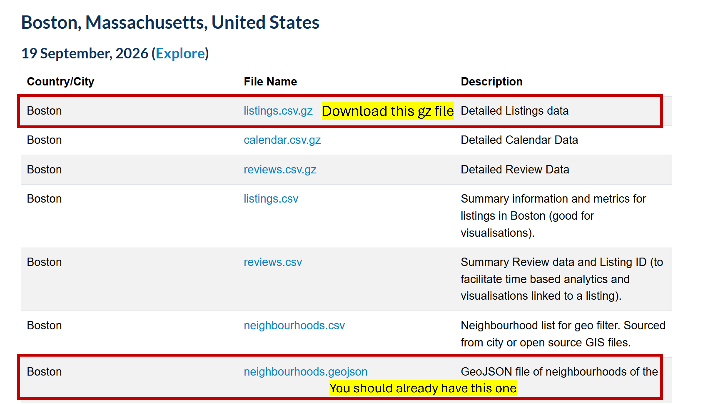

# Overview

In this lab, we will transform your Airbnb Leaflet map into an interactive Shiny web application. Shiny is one of the most beginner-friendly tools for building web apps. We’ll give you an introduction and show you plenty of potential for scaling up. If you find it useful, feel free to incorporate Shiny apps into your own project.

A Shiny app is a plain and humble **.R** file, partly because it was developed long before Quarto documents and other tools. So, we will create the project folder for this week, then start a new R script file (**File -\> New File -\> R script**). Save the file with the name "**app.R**".

# Shiny Essentials

As a brief review, a Shiny app is built on two essential components: **the User Interface (UI) and the Server**. These are fancy names, but UI is what you see in your browser, controlling the layout and appearance of the app. The Server is the R code you write, handling data processing behind the scenes.

A Shiny app always starts from a three-line template:

```{r}
#| eval: false
library(shiny)

ui <- fluidPage(
  # *Input functions go here
  # *Output functions go here
)

server <- function(input, output) {
  # output$id <- render*function(input$id)
}

shinyApp(ui, server)
```

In `ui`, you can define the...

1.  Components that **acquire user inputs** (e.g. sliders, select box, radio buttons, etc.)
2.  Components that will **display outputs** (e.g. plots, maps, tables, text boxes, etc.)
3.  Layout, themes, etc.

In `server`, most of the app's dynamic behavior occurs. The `server` works as an open, running function that takes the `input` from `ui`, produces the result in concert with a `render` function, then display the result to the `output` space on the `ui`.

The last line `shinyApp(ui, server)` combines these two parts together so that the app will *react* to the user input (`ui`) by *re-rendering* (`server`) continuously while the app is running.

# Visualize Airbnb data in Shiny

Flexdashboard is simple to use and perfect for showing multiple visualizations, and in many cases, it's all we need. However, Shiny allows you to build web apps that respond to user input, where users can choose what to display and explore results in real time.

## Preparation

This time we will download the **listings.csv.gz** file for Boston. This is “Detailed Listings data”, containing a lot more attributes than the cleaned summary data. It's provided in `.gz` format (a compressed file), but fear not, `read_csv()` is powerful enough to read and decompress it automatically.



Make sure today's project folder includes the **listings.csv.gz** file in your data folder. Then we set up your environment by loading the necessary packages and reading in the Airbnb data.

You can copy and paste the code below into your R script to get started:

```{r}
#| eval: false
#| source-line-numbers: "2-7"

# install.packages("shiny")
library(shiny)
library(leaflet)
library(tidyverse)

airbnb <- read_csv("data/listings.csv.gz")

ui <- fluidPage(
  # *Input functions go here
  # *Output functions go here
)

server <- function(input, output) {
  # output$id <- render*function(input$id)
}

shinyApp(ui, server)
```

## Design your UI

We will start by building an app that has one slider that allows users to control the price range, and one map that displays listings that fall within the selected price range.

The UI for this app consists of two main elements: the slider (an input), and the map (an output).

UI is built using **input and output functions**. The slider is linked to an input function, and the Leaflet map is linked to an output function. You can explore [a complete list of input and output functions](https://shiny.posit.co/r/components/).

For this particular UI, we should use `sliderInput()` to describe the slider’s appearance. The `inputId` is required, and you can give it any name that you can later use to reference the slider.

```{r}
#| eval: false
#| class-source: "numberLines"
#| source-line-numbers: "2-4"
ui <- fluidPage(
  sliderInput(inputId = "price_slider",
              label = "Choose a price range",
              min = 1, max = 500, value = c(100, 300)),
  # *Output functions
)
```

The output is a Leaflet map, generated using the `outputLeaflet()` function. We will use this function here for the output object and assign it a name for reference.

```{r}
#| eval: false
#| class-source: "numberLines"
#| source-line-numbers: "5"
ui <- fluidPage(
  sliderInput(inputId = "price_slider",
              label = "Choose a price range",
              min = 1, max = 500, value = c(100, 300)),
  leafletOutput(outputId = "map")
)
```

Without changing anything in the server part, let's click "Run App" to see what we have now. A viewer will open up showing the layout of your app: a slider and a empty area ready for output map. Close the viewer. In order to actually show the map, we will need to process the data in the `server` function.

## Assemble inputs and outputs in server

**Inside the curly braces of the server function template**, we will write all the instructions to create the Leaflet map. It is recommended to compose the code in three steps:

**First, we will establish the connections between particular inputs and outputs.** Right now we have only one input object `price_slider`, and one output object `map`, we should build this connection that the `output$map` will depend on the values of `input$price_slider`.

```{r}
#| eval: false
server <- function(input, output) {
  output$map <- input$price_slider
}
```

**Next, choose a render function that is associated with your output function.** When building the UI we have reserved an area for `leafletOutput()`, so in the server we must use a `renderLeaflet()` function to produce the corresponding result. The connections between all output functions and render functions are also listed in the [Shiny render functions page](https://shiny.posit.co/r/getstarted/build-an-app/reactive-flow/render-functions.html).

```{r}
#| eval: false
#| class-source: "numberLines"
#| source-line-numbers: "2"
server <- function(input, output) {
  output$map <- renderLeaflet(
    input$price_slider
  )
}
```

**Lastly, we'll process the input variable.** That means we will consider how user inputs (price ranges) influence the map. If we only want to display properties within the selected price range, we will use the slider's two end values (`input$price_slider[1]` and `input$price_slider[2]`) to `filter` the `airbnb` dataset, so that the map plots this filtered dataset.

```{r}
#| eval: false
#| class-source: "numberLines"
#| source-line-numbers: "3-7"
server <- function(input, output) {
  output$map <- renderLeaflet({
    
    # make a filtered dataset
    filtered_airbnb <- 
      airbnb |> 
      filter(price >= input$price_slider[1] & price < input$price_slider[2])
  })
}
```

For the mapping part, start by adding some basic Leaflet code:

```{r}
#| eval: false
#| class-source: "numberLines"
#| source-line-numbers: "9-12"
server <- function(input, output) {
  output$map <- renderLeaflet({
    
    # make a filtered dataset
    filtered_airbnb <- 
      airbnb |> 
      filter(price >= input$price_slider[1] & price < input$price_slider[2])
    
    # pass the filtered dataset to a simple leaflet map
    leaflet() |> 
      addTiles() |> 
      addCircles(data = filtered_airbnb)
  })
}
```

All parentheses should be properly paired up. **Note: We added a pairs of curly braces inside `renderLeaflet()`.** This is necessary because `{}` allows us to group multiple lines of code into a single block that will be evaluated together.

We have to treat the `price` column first, otherwise they are not proper numeric values. We’ll include the cleaning step right after loading the dataset.

```{r}
#| eval: false 
#| source-line-numbers: "3-7" 
airbnb <- read_csv("data/listings.csv.gz")  

airbnb <-
  airbnb |>
  mutate(price = str_replace_all(price, "[$,]", "")) |>    
  mutate(price = as.numeric(price))
```

Once you’ve completed the server code above, click "Run App" again to check if the slider and reactive map appear as expected.

## Add map styles

Everything you created for your previous Leaflet map will still work here! I’d suggest going back to your code from your leaflet map and reuse the `leaflet()` code to replace the basic version we now have in the server. However, be mindful of two things:

1.  You will need copy the **color palette** and the **popup format** too. If you have defined more elements for your map, make sure that they are all copied over. **Place them inside `renderLeaflet()`**.

```{r}
#| eval: false
#| source-line-numbers: "8-16,19-42"

server <- function(input, output) {
  output$map <- renderLeaflet({
    # make a filtered dataset
    filtered_airbnb <- 
      airbnb |> 
      filter(price >= input$price_slider[1] & price < input$price_slider[2])
    
    popup_format <-
      paste0("<b>Name:</b>", filtered_airbnb$name, "<br>",
             "<b>Host Name: </b>", filtered_airbnb$host_name,"<br>",
             "<b>Price: </b>", "$", filtered_airbnb$price, "<br>",
             "<b>Rate: </b>", filtered_airbnb$review_scores_rating
      )
    
    pal <- colorFactor(palette = "RdYlGn", domain = airbnb$room_type)
    
    # use the filtered dataset to make a simple leaflet map
    leaflet() |>
      addProviderTiles(providers$Esri.WorldGrayCanvas,
                       group = "ESRI World Gray") |>
      addProviderTiles(providers$Esri.WorldImagery, 
                       group = "ESRI World Imagery") |>
      addProviderTiles(providers$Stadia.AlidadeSmoothDark, 
                       group = "Stadia Dark") |>
      addCircleMarkers(data = filtered_airbnb,
                       lng = ~longitude, lat = ~latitude,
                       radius = 5,                 # pixels, not meters
                       fillColor = ~pal(room_type),
                       fillOpacity = 0.9,
                       color = "white", weight = 1, # thin outline so dots pop on imagery
                       popup = popup_format, 
                       group = "Airbnb Listings") |>
      addLegend(
        position = 'topright',
        pal = pal,
        values = airbnb$room_type,
        title = "Room Type") |> 
      addLayersControl(
        baseGroups = c("ESRI World Gray", 
                       "ESRI World Imagery",
                       "Stadia Dark"),
        overlayGroups = c("Airbnb Listings")
      )
  })
}
```

Once you’ve finished editing the server code, click "Run App" and check if again the price range works correctly, and if the colors and popups display as expected.

# Exercise

We'll start our exercise here, building on our current version of the web app and gradually expanding it into a more advanced one. By the end, your final app will look like [this example](https://ccong2.shinyapps.io/shiny/). The map will zoom into a user-selected neighborhood, display only the listings within that area, and include additional interactive selection options.

Observe the example you will notice:

-   There are more than one input (three!), so be prepared to include and manage **multiple input elements**.
-   On the map, both the **property points** *and* the **neighborhood boundary** are filtered. This means you'll read in the neighborhood boundary spatial data and apply a similar filtering to it.

### Steps

1.  **Read in the neighborhood boundary geojson file.** Remember to load the `sf` package and place the `st_read()` function in the correct place.

2.  **Add a select box input function to the UI.** Define its appearance and behavior using suitable arguments (e.g., id, label, choices)

3.  **Add a radio button input to the UI.** This is like a hotel-booking-website-style selection that shows of different rating levels. The unique thing is the `choices` is not from any data source but are directly defined by us:

    ```{verbatim}
    choices = c("Wonderful: 5", "Very Good: 4.8+", 
                "Good: 4.5+", "All")
    ```

<!-- -->

5.  **Update the server code:**

-   All three inputs are connected to the map output (`output$map`). The render function `renderLeaflet()` stays the same.

-   The main focus is on further filtering the Airbnb listings. Previously, we filtered by a single condition (price); now we will add two additional filter conditions. Update `filtered_airbnb` by adding more filtering steps.

    When doing this, one problem is how to translate the radio button input (a **string**, e.g. input\$rating = "Wonderful: 5") into a **condition**, (e.g. rating_score_rating ==5).

    Here is my code for this part. I define a numeric value `min_score` based on the string descriptions. Then use `min_score` in the filtering logic for `filtered_airbnb`.

    ```{r}
    #| eval: false
    #| source-line-numbers: "4,5,6,7,8,9,10,17"

    output$map <- renderLeaflet({
      
      # Define a value based on the string description
      min_score <- case_when(
        input$rating == "Wonderful: 5" ~ 5,
        input$rating == "Very Good: 4.8+"   ~ 4.8,
        input$rating == "Good: 4.5+"        ~ 4.5,
        TRUE                              ~ 0
      )
        
      # Further filter the dataset
      filtered_airbnb <- 
        airbnb |> 
        filter(price >= input$price_slider[1] & price < input$price_slider[2]) |> 
        filter(neighbourhood_cleansed == input$nbh_name) |> 
        filter(review_scores_rating >= min_score)
      
    })
    ```

-   Lastly, filter the **neighborhood boundaries** to match the user-selected neighborhood (`input$nbh_name`) and add it to `addPolygons()` so the map displays only the chosen neighborhood.

**Once you have a working app:** Arrange your app using [a sidebar layout](https://shiny.posit.co/r/reference/shiny/1.0.0/sidebarlayout.html) so it matches the example. This means placing your input functions in the appropriate panel sections of the UI.

```{r}
#| eval: false
ui <- fluidPage(
  titlePanel(),
  sidebarLayout(
    sidebarPanel(),
    mainPanel()
  )
)
```

Click "Run App" to see your shiny app in action. If any errors pop up, feel free to find our teaching team to work through them together.

# Publish your Shiny App

[shinyapp.io](https://www.shinyapps.io/) is the best place for you to host, display, and distribute your Shiny apps. The platform is designed for Shiny and R language so all your reactive elements will work seamlessly. If it's the first time you connect with shinyapp.io, you may have to sign up for an account.

Check if your script is named **app.R**. This is the naming convention for Shiny apps, as it allows the platform to recognize and properly deploy your application.

To publish your app, just like with other documents, use the **blue "Publish" button**. Then, select the option for ShinyApps.io. [Here](https://statsandr.com/blog/how-to-publish-shiny-app-example-with-shinyapps-io/#step-by-step-guide) is a step-by-step screenshot guide for setting up your account, initializing your account, and hosting with shinyapps.io.

At the step of choose "Publish Files From...", make sure to include all the data files you used as well. In our case, we should select "app.R", "listings.csv.gz", and "neighbourhood.geojson".

{width="590"}

When you see it working like this, it means it’s being successfully published.

{width="590"}
